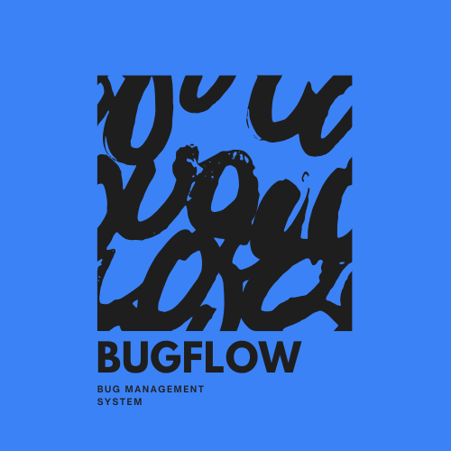

 

  

   

  

    <a href="https://portfolio-7ps6.vercel.app/">PORTFOLIO ↗</a>
    &nbsp; / &nbsp;
    <a href="https://www.linkedin.com/in/sohailansari163/">LINKEDIN ↗</a>
    &nbsp; / &nbsp;
    <a href="mailto:sohailansarisa318@gmail.com">EMAIL ↗</a>
  

---

<table>
<tr>
<td width="50%" valign="top">

### 02. / ABOUT

Computer Science undergraduate and Full-Stack Developer building practical products that solve real problems.

I work with the MERN stack, React Native, AWS, and modern development tools. Interested in reliable systems, useful interfaces, and software that makes a difference.

**Currently focused on**
- Full-stack product development
- Data structures and algorithms
- Linux administration and cloud technologies

</td>
<td width="50%" valign="top">

### 03. / TECH STACK

</td>
</tr>
</table>

---

### 04. / CERTIFICATION

<table>
<tr>
<td width="70">

</td>
<td>

**Red Hat Certified System Administrator**

RHCSA · Red Hat Enterprise Linux

Linux administration · System services · Storage · User management

</td>
</tr>
</table>

---

### 05. / EXPERIENCE & RECOGNITION

**AWS Student Builder Club, GITS**  
`TECH LEAD · OCT 2025 – PRESENT`

Leading technical workshops, mentoring students, and supporting cloud learning initiatives.

**AI/ML Trainee · Grras Solutions**  
`45-DAY TRAINING PROGRAM`

Practical training in machine learning, deep learning, Python, data preprocessing, and model evaluation.

**Selected achievements**

- 2nd Runner-Up · Internal Smart India Hackathon 2025
- 2nd Runner-Up · DSA Forge
- Finalist · CodeFiesta 3.0 Hackathon
- Best Research Paper · SPSU International Research Conference
- Participant · Google LakeCity Hackathon

---

### 06. / SELECTED WORK

<table>
<tr>
<td width="50%" valign="top">

#### BugFlow

A full-stack bug tracking platform for managing issues, authentication, and collaborative workflows.

`REACT` `NODE.JS` `EXPRESS` `MONGODB` `JWT`

[VIEW PROJECT ↗](YOUR_BUGFLOW_REPO_URL)

</td>
<td width="50%" valign="top">

#### SudhaarX

A civic issue reporting application with geo-tagging, complaint tracking, and an administrative dashboard.

`REACT NATIVE` `NODE.JS` `MONGODB` `FIREBASE`

[VIEW PROJECT ↗](YOUR_SUDHAARX_REPO_URL)

</td>
</tr>
</table>

---

### 07. / GITHUB ACTIVITY

---

<strong>STAY CURIOUS. KEEP BUILDING. BECOME UNDENIABLE.</strong>

SOHAIL ANSARI · FULL-STACK DEVELOPER · 2026

